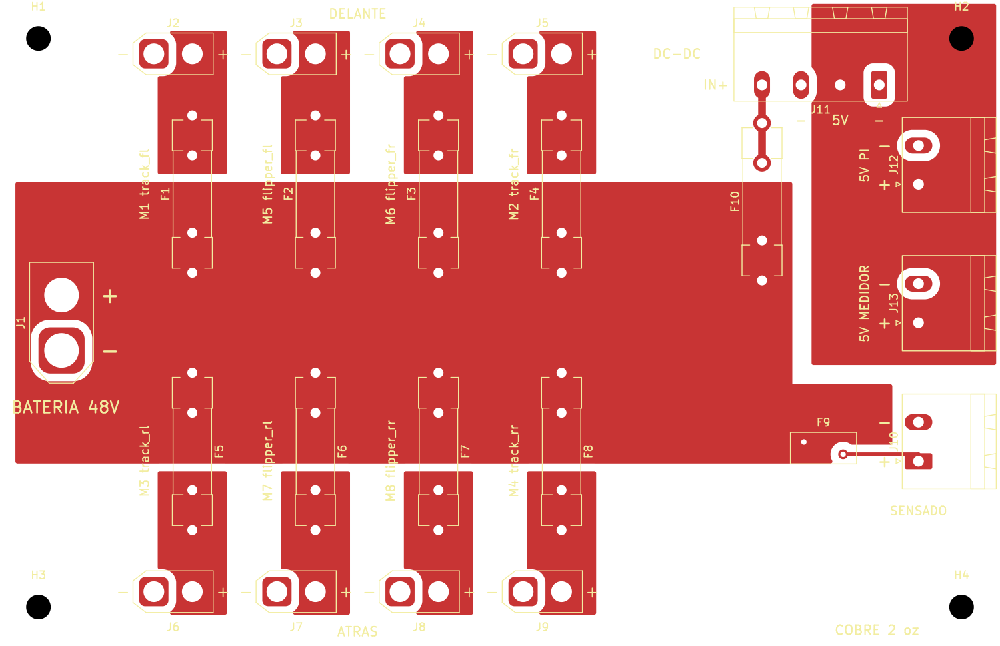

# Distribución de 48 V — XT60 a 8 motores con fusible

Placa de 2 capas, 130 × 84 mm. Recibe la batería por un **XT60**, la reparte a los
**8 drivers GIM6010-8** por **XT30** con un **fusible cerámico 5×20 por motor**,
alimenta un **reductor de 5 V externo** (para la Raspberry Pi y el medidor) y saca una
línea de sensado protegida hacia el medidor de batería (`../pcb_bateria_48v`).



**Todo es pasante.** Los XT60 y XT30 son los de cable de siempre (cuerpo amarillo,
patas para soldar), montados **en vertical**: el enchufe entra desde arriba de la
placa. Las huellas son las de la librería oficial de KiCad 10 (AMASS, Littelfuse,
Bel Fuse, Phoenix): las cotas vienen del fabricante, no reconstruidas.

## Archivos

| Archivo | Qué es |
|---|---|
| `distribucion48v.kicad_pcb` | La placa, con los planos ya rellenos. |
| `gen.py` | Fuente paramétrica: constantes arriba, `python3 gen.py` regenera todo. |
| `fabricacion/` | Gerbers y taladros listos para mandar. |
| `bom.csv` | Lista de materiales. |
| `preview.png` | Cara superior: cobre y serigrafía. |
| `render3d.png` | Vista 3D de KiCad (sin modelo 3D de los XT30 ni de los clips). |
| `PENDIENTES.md` | Lo que hay que comprobar antes de fabricar. |
| `COMPRAS.md` | Lista de compras con cantidades. |

## Cómo está armada

```
 batería ──XT60 J1──┬── F1 ── J2  M1 track_fl      (fila de arriba = DELANTE)
                    ├── F2 ── J3  M5 flipper_fl
                    ├── F3 ── J4  M6 flipper_fr
                    ├── F4 ── J5  M2 track_fr
                    ├── F5 ── J6  M3 track_rl      (fila de abajo = ATRÁS)
                    ├── F6 ── J7  M7 flipper_rl
                    ├── F7 ── J8  M8 flipper_rr
                    ├── F8 ── J9  M4 track_rr
                    ├── F9 (PTC) ── J10 ──> J1 del medidor (sensado)
                    └── F10 T2A ── J11 IN+ ──> módulo DC-DC ──> J11 5V ──┬── J12 5V PI
                                                                         └── J13 ──> J2 del medidor
```

- **Cara superior (F.Cu):** el bus `VBAT`, una franja ancha que toca el XT60 y el
  lado de entrada de los 8 fusibles. Cada canal tiene su propio plano `OUTn`,
  desde la salida del fusible hasta el `+` de su XT30.
- **Plano `+5V` (F.Cu):** arriba a la derecha, de la salida del módulo a J12 y J13.
  Está pensado para 5 A.
- **Cara inferior (B.Cu):** GND entera. Por ahí vuelve la corriente de los 8 motores.
- **1 mm** de separación entre planos de distinta red. Para 48 V basta con 0.6 mm
  según IPC-2221; es el mismo margen que usa la placa del medidor.

Las salidas van **agrupadas por esquina**, igual que los buses CAN en
`src/ugv_bridge/config/geometria_robot.yaml`. La oruga y el flipper de la misma
esquina quedan juntos, y cada rótulo lleva el ID del motor y su nombre en el código.

## Polaridad y géneros

En las huellas AMASS **el pad 1 es el negativo (del lado del chaflán del cuerpo) y
el pad 2 el positivo**. Lo marca la serigrafía `-` / `+` de la huella del XT30U; la
del XT60 vertical no trae marca y se la agrega `gen.py` con el mismo criterio.

| Conector | En la placa | Lo que enchufa |
|---|---|---|
| J1 batería | **XT60 macho** (pines), vertical | el XT60 hembra del pack |
| J2–J9 motores | **XT30 hembra**, vertical | un XT30 macho en el cable del motor |

Las salidas son hembra para que, con la batería puesta, no queden pines con tensión
al aire.

**El cable de cada motor no es un XT30 a XT30.** El driver trae un XT30(2+2), que
lleva VBUS y GND y también CANH y CANL. El cable lleva un XT30 macho de 2 pines del
lado de la placa y un XT30(2+2)-F del lado del driver; los dos hilos de CAN llegan
a ese mismo conector, pero salen del pi3hat y no de esta placa.

## Reductor de 5 V

El reductor **no va soldado en la placa**: es un módulo DC-DC aparte, atornillado al
chasis o sobre la placa con separadores, que se conecta a **J11** con cables cortos.
Así sirve cualquier módulo, y si se quema se cambia sin tocar la placa.

| J11, de izquierda a derecha | Va a |
|---|---|
| `IN+` | entrada + del módulo (48 V, después de F10) |
| `-` | entrada − del módulo |
| `5V` | salida + del módulo |
| `-` | salida − del módulo |

**Qué módulo comprar:** entrada de **60 V o más** (mejor 72 V), porque la batería
llena llega a 54.6 V, y **5 V fijos a 5 A o más**. Los LM2596 y XL4015 comunes **no
sirven**: son de 40 V o menos, o de 3 A.

| Salida | Para | Corriente |
|---|---|---|
| **J12 5V PI** | Raspberry Pi 4, por los pines del GPIO: 5V (pin 2 o 4) y GND (pin 6) | 3 A |
| **J13 5V MEDIDOR** | el **J2** del medidor (`1` = 5 V, `2` = GND) | < 0.5 A |

**F10 (T2A 5×20)** protege la entrada del módulo: 25 W a 48 V son ~0.6 A.

Al alimentar la Pi por el GPIO se salta su fusible interno. Por eso el cable de J12
tiene que ser corto y grueso (18 AWG / 0.75 mm²): con un cable delgado, la caída de
tensión hace que la Pi avise de bajo voltaje.

## Corriente

Del manual del GIM6010-8: **6 A nominal** por driver y **30 A** como máximo de línea.
Los motores van a trabajar a **~50 %** de su capacidad, unos **3 A** cada uno, y la
placa está dimensionada para eso.

| Pieza | Aguanta | Comentario |
|---|---|---|
| Fusible 5×20 | **10 A, retardado (T)** | el retardo deja pasar los picos de arranque |
| XT30 | 15 A continuos | sobra para 3 A |
| Plano por canal (2 oz) | ~15 A con 20 °C de subida | 6.6 mm de ancho en el punto más estrecho |
| Bus de 48 V (2 oz) | ~25 A | con 8 motores a 3 A |
| XT60 | 30 A continuos | ver abajo |

### Fusibles

**Cerámicos de 5×20 mm, 10 A, retardados (T10A), de 250 V.** Son los de tubo de
toda la vida, fáciles de conseguir (en AliExpress, "fusible cerámico 5x20 T10A").

- **Cerámicos, no de vidrio.** Por dentro tienen arena, que apaga el arco cuando el
  fusible se funde; el de vidrio puede no cortar bien en un corto de una batería.
- **Retardados (T), no rápidos (F).** Un motor pide mucho más al arrancar; el rápido
  saltaría en cada arranque.
- La marca de 250 V es de alterna. En continua el arco es más difícil de cortar,
  pero a 48 V queda con mucho margen. Si el vendedor da un valor en DC, mejor.

Van en **clips Littelfuse serie 445-030** (`0445 0001` / `0030 0210`, 10 A), dos
por fusible, con 2 patas a 5.2 mm. Otro clip de 5×20 no tiene por qué calzar: la
separación de las patas cambia de un modelo a otro.

**Si los motores pasan del 50 %**, esta placa se queda corta: 10 A es el máximo del
formato 5×20. Habría que volver a fusibles más grandes (6.3×32 o ATO de 58 V).

**El XT60 es el límite si se sube la carga.** A 3 A por motor son ~24 A en total,
dentro de lo que aguanta. Si la medición muestra más de ~30 A sostenidos, hay que
pasar a XT90. KiCad no trae huella del XT90 vertical de cable (solo el XT90PW
acostado, `AMASS_XT90PW-M_1x02_P10.90mm_Horizontal`), así que habría que usar ese o
dibujar la huella.

## Fabricación

- **Cobre de 2 oz (70 µm), obligatorio.** Los anchos están calculados para 2 oz. Con
  1 oz el bus de 48 V se queda corto para los ~25 A de los 8 motores. Hay que pedirlo así en el formulario
  del fabricante; también está escrito en la serigrafía.
- Los pads de potencia van **conectados al plano sin thermal relief**, para que no se
  pierda corriente en los radios. Esto hace más difícil soldarlos: se necesita un
  cautín de 80 W o más con punta gruesa, o precalentar la placa.
- Los gerbers de `fabricacion/` ya incluyen los planos rellenos.

## Regenerar

Necesita KiCad 10 (la API `pcbnew` de Python):

```
python3 gen.py
kicad-cli pcb drc --refill-zones --severity-all distribucion48v.kicad_pcb
kicad-cli pcb export gerbers --layers F.Cu,B.Cu,F.Mask,B.Mask,F.Silkscreen,B.Silkscreen,Edge_Cuts -o fabricacion/ distribucion48v.kicad_pcb
kicad-cli pcb export drill --format excellon --excellon-separate-th -o fabricacion/ distribucion48v.kicad_pcb
```

`gen.py` **sobrescribe** el `.kicad_pcb`: cualquier cambio hecho a mano en KiCad se
pierde, así que los arreglos se hacen en el script.

Estado al generarla: DRC de KiCad 10.0.7 con **0 violaciones y 0 sin conectar**.

## Lo que no incluí

- **Antichispa / precarga.** Al enchufar el XT60, los condensadores de los 8 drivers
  cargan de golpe y salta una chispa. Si molesta, la opción más simple es un
  XT90-S (antichispa) en el cable de la batería.
- **LED por canal** para ver qué fusible se quemó.
- **Interruptor general** o parada de emergencia: van en el cable de la batería, no en
  la placa.
