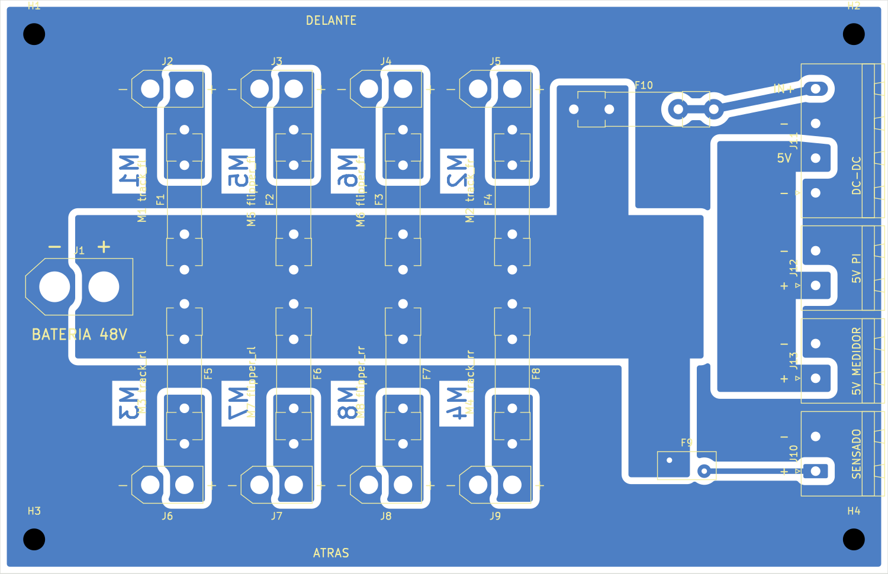

# Distribución de 48 V — versión para la CNC del laboratorio

El circuito es el mismo de [`../pcb_distribucion_48v`](../pcb_distribucion_48v/README.md):
XT60 de batería, 8 salidas XT30 con fusible 5×20, bornera para el reductor de 5 V
externo, 5 V a la Pi y al medidor, y sensado con PTC. Cambia el cobre, para poder
fresarla en la **Bungard CCD** del laboratorio (manual en `../CNCFABLAB/`).



## Qué cambia respecto de la placa para fabricante

| | Fabricante (`pcb_distribucion_48v`) | CNC (esta) |
|---|---|---|
| Caras de cobre | 2 (48 V arriba, GND abajo) | **1, la de abajo (lado de soldadura)** |
| Cobre | 2 oz (70 µm) | **1 oz (35 µm)**, el de las placas vírgenes comunes |
| Metalizado de agujeros | sí | **no**: la CCD no metaliza |
| Serigrafía / máscara | sí | no; los rótulos `M1`…`M8` van fresados en el cobre |
| Taladro de los clips | 1.3 mm | **1.4 mm**, el mismo de las borneras: una broca menos |
| Tamaño, agujeros M3 | 130 × 84 mm | igual: se atornilla en el mismo lugar |

**Por qué una sola cara:** sin metalizado, un pad solo conecta en la cara donde se
suelda. Los XT60 y XT30 van verticales con el cuerpo apoyado en la cara de arriba, así
que un pad de arriba quedaría tapado y no se podría soldar. Todo el cobre va abajo,
donde se sueldan todas las patas.

**Cómo entra en una cara:** GND rellena todo lo que no es otra red. Queda un anillo
por el borde que toca los `-` del XT60, de los ocho XT30 y de las borneras. Adentro
van el bus de 48 V (franja central), los planos `OUT1`…`OUT8` (uno por canal, del
fusible al `+` de su XT30), el plano de 5 V (peine a la izquierda de las borneras) y
dos pistas (IN+ del reductor y sensado). Nada se cruza. El DRC da **0 sin conectar**.

## Archivos

| Archivo | Qué es |
|---|---|
| `fabricacion/distribucion48v_cnc-B_Cu.gbl` | Cobre (cara **de abajo**). Gerber RS-274X, sin atributos X2. |
| `fabricacion/distribucion48v_cnc-Edge_Cuts.gm1` | Contorno de la placa. |
| `fabricacion/distribucion48v_cnc.drl` | Taladros, Excellon en mm, un solo archivo (70 agujeros, 5 diámetros). |
| `montaje_1a1.pdf` | Vista de arriba a **escala 1:1**: para imprimir y comprobar los conectores. |
| `preview.png` | Cara de arriba con el cobre de abajo visto por transparencia. |
| `cobre_lado_soldadura.png` | El cobre visto desde abajo, como queda la placa fresada. |
| `gen.py` | Fuente: `python3 gen.py` regenera todo. |

Los componentes son los mismos de la otra placa: ver su `bom.csv` y `COMPRAS.md`.
Además hace falta **una placa virgen FR4 de 1.6 mm, una cara, 35 µm**, de al menos
150 × 95 mm. La Eurocard de 160 × 100 sirve.

## En la CCD, paso a paso

Basado en el manual de la Bungard CCD (RoutePro3000). Los números de página son los
del manual.

### 1. Poner la placa

- **Cobre hacia arriba.** La fresa trabaja desde arriba. Los componentes van después
  en la otra cara, la sin cobre.
- Debajo, una **placa de sacrificio** (MDF o la "drill backing board" del
  laboratorio) más grande que la virgen, fija a la mesa con las bridas. Así las
  brocas y la fresa de contorno la atraviesan sin tocar la mesa de aluminio (p. 24).
- La placa virgen va pegada a la de sacrificio con **cinta doble faz**, bien plana y
  sin burbujas. Con una sola cara no hacen falta pines de referencia (p. 24–25). Si
  la placa se curva, la aislación sale más honda en unas partes que en otras.
- Ubicarla a unos **5 mm del cero de la máquina**, en la esquina de adelante a la
  izquierda, con un borde alineado con el eje X o Y (p. 17 y 20).
- En el software, cargar el **espesor real** de la placa (1.6 mm) y el de la de
  sacrificio (p. 20).

### 2. Cargar los archivos

En RoutePro3000/IsoCam: el `.drl` como taladros, el `B_Cu.gbl` como **capa de abajo**
y el `Edge_Cuts.gm1` como contorno. El gerber está visto desde arriba, como todo
gerber: al marcarlo como capa de abajo, el software lo espeja. **Comprobar en
pantalla que los rótulos `M1`…`M8` se leen al derecho en la vista de abajo**: si se
leen espejados, la placa sale al revés.

### 3. Fresar, y cuándo cambiar de herramienta

Son **5 herramientas** y se usan en este orden (p. 21). Cada fila es un cambio: se
termina todo lo de esa herramienta antes de pasar a la siguiente.

| Cuándo | Herramienta | Qué hace |
|---|---|---|
| 1. Al empezar, capa de taladros | broca **0.8 mm** | los 2 agujeros del PTC (F9) |
| 2. Cuando termina la 0.8 | broca **1.4 mm** | los 46 agujeros de clips y borneras |
| 3. Cuando termina la 1.4 | broca **2.7 mm** | los 16 agujeros de los XT30 |
| 4. Terminados los taladros, se cambia a la capa de aislación | fresa de aislación **0.5 mm** (o la V que tengan) | separa las redes en el cobre |
| 5. Terminada la aislación, se cambia a la capa de contorno | fresa de contorno **2.0 mm** | XT60 (4.5 mm) y M3 (3.2 mm) como círculos, y al final el borde de la placa con puentes |

Cómo se hace cada cambio depende de la máquina:

- **Con cambiador automático (ATC)**, la barra de portaherramientas al frente:
  antes de empezar se ponen las 5 herramientas en los puestos que pide el software,
  con el **puesto 0 libre** para el pin de prueba. Al dar Start, la máquina mide
  cada una y las cambia sola (p. 19–21).
- **Manual (MTC o sin cambiador):** al terminar con una herramienta, el eje Z sube y
  el software pide la siguiente. Se cambia **con el husillo detenido**: apretar el
  botón de arriba del husillo, girar hasta que trabe, soltar la pinza (p. 19). Después
  de poner la nueva, OK.

En cualquiera de los dos casos:

- **Todas las herramientas con el anillo de tope** a 21 mm de la punta (p. 11). Con
  él la máquina sabe el largo; sin él, puede clavar la herramienta en la mesa.
- **No tocar la herramienta con el husillo girando**; esperar a que se detenga (p. 9).
- **Para la aislación, el limitador de profundidad** (el patín verde alrededor de la
  fresa): corta siempre lo justo aunque la placa no esté perfecta (p. 21–22).
  Con ATC, la abertura del patín mira hacia los portaherramientas; si no, choca en
  el cambio (p. 22).
- **Antes de la aislación completa, probar la profundidad** en un trazo que no
  importe, por ejemplo el contorno exterior, como sugiere el manual: tiene que
  cortar el cobre y apenas marcar la fibra. Si queda cobre, bajar el limitador un
  punto (cada punto son 50 µm). Mejor que quede alto que hondo (p. 22).

### 4. Después de fresar

Antes de soldar, con el multímetro en continuidad, medir que **no** suene entre GND,
VBAT, +5V y cada OUT. Una rebaba o una tira de cobre que no se fresó deja un corto a
48 V.

### Herramientas y parámetros (FR4, tablas del manual)

| Paso | Herramienta | Diámetro | Avance XY | RPM | Avance Z | Página |
|---|---|---|---|---|---|---|
| Taladro (PTC, 2) | broca estándar | 0.8 mm | 2200 mm/min | 63 000 | — | 29 |
| Taladro (clips y borneras, 46) | broca estándar | 1.4 mm | 2800 mm/min | 63 000 | — | 29 |
| Taladro (XT30, 16) | broca estándar | 2.7 mm | 1800 mm/min | 45 400 | — | 29 |
| Agujeros M3 (3.2 mm, 4) y XT60 (4.5 mm, 2) | ver abajo | | | | | 29 |
| Aislación | fresa de un filo (micro cutter) | 0.5 mm | 100–200 mm/min | 63 000 | 200 mm/min | 31 |
| Contorno | fresa SC/FT | 2.0 mm | 1000 mm/min | 38 800 | 1300 mm/min | 32 |

- **Agujeros de más de 3 mm:** el manual recomienda pretaladrar con 1.7 mm desde
  3.0 mm. Con el diámetro máximo recomendado de 3.175 mm, lo más simple es que
  RoutePro/IsoCam los **frese como círculo** con la fresa de contorno. Si el
  laboratorio tiene broca de 3.2 y de 4.5, también sirve.
- **Ancho de aislación: 1 mm.** Las redes están separadas 1 mm en el diseño. Para
  48 V sin barniz, IPC-2221 pide **al menos 0.6 mm**: una sola pasada de una fresa
  de 0.2–0.4 mm **no alcanza**. Pedir en IsoCam un ancho de aislación de 1 mm, por
  ejemplo dos pasadas de 0.5 mm, o una fresa de 1 mm.
- **Contorno con puentes** (p. 25) para que la placa no salte al final del corte.

## Corriente con cobre de 1 oz

Anchos en el punto más estrecho. Capacidad según IPC-2221, capa externa, con 20 °C de
subida de temperatura.

| Tramo | Ancho | Aguanta | Lleva (motores a ~3 A) |
|---|---|---|---|
| Plano por canal `OUTn` | 5 mm (junto al `-` del XT30) | ~10 A | 3 A (6 A nominal del driver) |
| Franja de GND arriba / abajo | 8.5 mm | ~15 A | 4 canales: ~12 A |
| Bus de 48 V | 21 mm | ~29 A | 8 canales: ~24 A |

Alcanza para lo que se pidió, con poco margen en las franjas de GND. Si se quiere más
margen, o si el cobre se oxida: **estañar** el bus, las franjas de GND y los planos
`OUT` (una capa de estaño suma sección), o soldar encima un alambre de cobre de
1.5 mm² a lo largo del bus y de las franjas.

## Después de fresar

- **No tiene máscara**: el cobre queda al aire. Estañarlo o pasarle barniz (laca
  para PCB, en spray) después de soldar. El barniz además mejora la aislación de 48 V.
- **Rótulos**: los `M1`…`M8` en cobre se leen desde abajo. Arriba no hay
  serigrafía: marcar con plumón permanente los IDs de motor junto a cada XT30, y
  `+`/`-` en el XT60 y las borneras, usando `montaje_1a1.pdf` de guía.
- Los pads de potencia van **sin thermal relief**, conectados de lleno al plano: se
  sueldan con un cautín de 60–80 W y punta gruesa. Con 1 oz cuesta menos que con
  2 oz.
- Al soldar los XT30/XT60, que el cuerpo quede **apoyado y recto** sobre la placa:
  sin metalizado, el pad de cobre es lo único que sujeta la pata. Si se
  tira del cable, se puede levantar el pad. Asegurar los cables con amarras al chasis.

## Antes de ir al laboratorio

- [ ] **Polaridad de los XT** (sigue pendiente, ver `../pcb_distribucion_48v/PENDIENTES.md`):
      imprimir `montaje_1a1.pdf` **al 100 %, sin "ajustar a la página"**, medir que
      la placa mida 130 × 84 mm en el papel, y poner encima un XT60 y un XT30 reales:
      el `-` moldeado en el cuerpo tiene que caer en el pad marcado `-`.
- [ ] Con el mismo papel, comprobar que las patas de los **clips 445-030** caen en los
      agujeros (dos patas a 5.2 mm, clip a clip 20.5 mm).
- [ ] Preguntar en el laboratorio:
  - ¿Tienen **placa virgen de una cara**? Si solo hay de doble cara, el cobre de
        arriba tiene que salir entero, o por lo menos fresar un anillo alrededor de
        cada agujero. Si no, las patas de los conectores tocan ese cobre y quedan
        todas en corto entre sí.
  - ¿Qué **fresas y brocas** hay en el cambiador? Hacen falta las brocas de 0.8,
        1.4 y 2.7 mm, una fresa de aislación (0.5 mm o un V-cut) y una fresa de
        contorno de 2 mm.
  - ¿Usan **IsoCam** para generar la aislación desde el gerber?

## Regenerar

Necesita KiCad 10 (la API `pcbnew` de Python):

```
python3 gen.py
kicad-cli pcb drc --refill-zones --severity-all distribucion48v_cnc.kicad_pcb
kicad-cli pcb export gerbers --layers B.Cu,Edge.Cuts --no-x2 --no-netlist -o fabricacion/ distribucion48v_cnc.kicad_pcb
kicad-cli pcb export drill --format excellon --excellon-units mm --excellon-zeros-format decimal --drill-origin absolute -o fabricacion/ distribucion48v_cnc.kicad_pcb
kicad-cli pcb export pdf --layers F.Silkscreen,F.Fab,Edge.Cuts --mode-single --sp --black-and-white -o montaje_1a1.pdf distribucion48v_cnc.kicad_pcb
```

Estado al generarla: DRC de KiCad 10.0.7 con **0 sin conectar** y 0 errores de
cobre. Quedan 36 avisos `silk_over_copper` (serigrafía sobre pads): no importan,
porque la CCD no imprime serigrafía.
